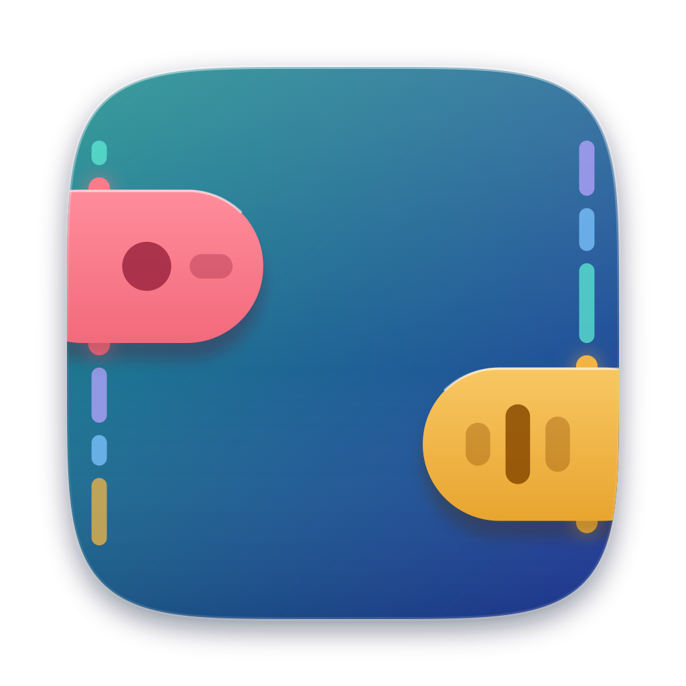

<div align="center">

<picture>
  <source media="(prefers-color-scheme: dark)" srcset="assets/Purah-icon-macOS-1024.png">
  
</picture>

# Purah
### macOS Magnetic Edge Rails & Ambient Ergonomic Kernel

[](https://swift.org)
[](https://apple.com/macos)
[](https://developer.apple.com/metal/)
[](https://github.com)
[](LICENSE)

<br />

English &nbsp;|&nbsp; [**简体中文 (Chinese)**](README_CN.md)

<br />

<!-- ═════════════════════ DEMO SHOWCASE ═════════════════════ -->
<p align="center">
  
  <br />
  <sub>🎬 <em>100% Real macOS screen recording edited with video-shotcraft &middot; <a href="assets/purah-showcase-30s.mp4">Watch 1080p Video with Audio</a></em></sub>
</p>
<!-- ═══════════════════════════════════════════════════════════ -->

</div>

---

<br />

### 💡 What is Purah?

**Purah** is an ultra-lightweight ambient desktop companion for macOS. Sitting silently as non-intrusive ambient strips along the physical borders of your screen, Purah activates when your cursor glides to the display bezel—springing interactive cards inward toward the center with physical, co-planar fluidity.

It runs quietly in the background without stealing focus or cluttering your Dock, guaranteeing **100% click-through pass-through** to underlying apps and code editors.

---

### ✨ Key Features

- **⚡️ Zero-Block Click-Through**: Transparent empty space lets clicks pass straight through to desktop windows, Finder, and IDEs without blocking your workflow.
- **🎛 Physical Bezel Extrusion**: Drawers slide smoothly out from the screen edge towards the center and retract solidly with zero ghosting.
- **🧱 Unified 3-Layer Elastic Rail Engine**: Stack any modules together like folders, enable optional Dynamic Breathing compression on crowded pages, and seamlessly overflow or organize across multi-page rail spaces with edge portals.
- **📐 1:1 Live Desktop Rail Sculptor (`⌃⌥E`)**: Sculpt, resize, stack/unstack, and move modules across edges and pages directly on your live desktop bezel.
- **💾 Configuration Backup & Restore**: Export, import, and factory-reset your entire workspace layout, shortcuts, and plugin preferences as portable JSON files.
- **💻 Edge Interactive Terminal**: Multi-tab persistent shell powered by [SwiftTerm](https://github.com/migueldeicaza/SwiftTerm) with full VT100/Xterm emulation, 1-click `cd` to active Finder folder, live font scaling, and Starship / Nerd Font glyphs.
- **🌊 60 / 120 FPS Fluid Waveform**: Metal GPU-driven audio visualizer that pulses naturally along the screen edge.
- **🖥 Multi-Display Adaptive**: Follows your cursor across displays while suppressing accidental triggers when crossing screen borders.

---

### 🧩 Built-in Plugins (10 Built-in Plugins)

| Plugin | Icon | Description |
| :--- | :---: | :--- |
| **AI Assistant** | `sparkles` | Multi-provider AI workbench supporting On-Device Apple Intelligence (`FoundationModels`), Local CLI Agents (`claude`, `codex`, `ollama`, custom), and OpenAI / Anthropic / Ollama HTTP APIs. Features frontmost selection capture, 50/50 split drop zones (New Session vs. Follow-up), inline diff polishing, custom role prompts, built-in local file skills, and MCP server integration. |
| **Hardware Vitals** | `waveform.path.ecg` | Deep Darwin/IOKit telemetry across a unified 2x2 overview grid (CPU User/Sys/LoadAvg/Thermal, GPU, RAM App/Wired/Compressed/Swap, Battery Health/Cycles), full-width Network I/O card, Disk R/W throughput, and full Process Inspector. |
| **Drop Shelf** | `tray.fill` | Desktop staging shelf with marquee rubber-band multi-selection, batch drag-out, 1-click ZIP & AirDrop, and pinned interactive floating sidecar preview (`👁`). |
| **Smart Clipboard** | `doc.on.clipboard.fill` | Instant history manager with marquee rubber-band multi-selection, batch drag-out, 1-click ZIP & AirDrop, pinned interactive floating sidecar preview (`👁`), color preview, image caching, and fuzzy search. |
| **Quick Notes** | `note.text` | Typora-style live Markdown & resizable tables, one-tag filing and instant search, image paste, and 1-click `.md` export. |
| **Terminal** | `apple.terminal.fill` | Multi-tab persistent shell powered by [SwiftTerm](https://github.com/migueldeicaza/SwiftTerm) with 1-click `cd` to active Finder folder, Starship & Nerd Font glyph support, and natural-language commands (`??`) that write the shell command for you. |
| **Music Waveform** | `waveform` | Apple Music playback controller with dynamic visualizer and fluid scrub bar. |
| **Calendar Timeline** | `calendar` | Day agenda timeline with meeting link detection (`Zoom`, `Meet`, `Teams`). |
| **Todo Checklist** | `checklist` | System Reminders integration with one-tap completion. |
| **Script Runway** | `terminal.fill` | Quick-fire developer automation runway for everyday maintenance tasks, with one-sentence script drafting: describe the job and review the zsh it writes. |

> 🚀 **More to come**: Additional plugins, custom widgets, and third-party developer extensibility are actively in development.

---

### ⚡ Natural-Language Commands in the Terminal (`??` / `???`)

Nobody remembers every flag. Describe the task in the terminal you already have open and Purah writes the command:

```zsh
❯ ?? find every file over 1 GB, sorted by size
⚡ Purah is thinking…
find . -type f -size +1g -exec du -h {} + | sort -rh
```

- **Nothing runs on its own.** The suggestion is placed on the input line, never executed — read it, edit it, then press Return.
- **`???` explains the last command**, with its exit status and the failure you just hit.
- **Risk is decided locally, not by the model.** Every suggestion is classified into `safe` / `caution` / `dangerous` from a fixed vocabulary by `CommandRiskClassifier`; anything destructive is printed in red before you can press Return.
- **It checks the machine, not just the model.** If the answer names a binary that is not installed here — `airport`, which Apple deleted in macOS 14.4 — Purah sends that fact back for one corrective turn instead of handing you a command that cannot run.
- **Typing `??` turns it pink and underlined** so the mode is visible *before* Return. The drawer footer names both commands (`??` is clickable there and types the two characters for you) and shows, at its right edge, which AI is answering and whether it is usable — a filled green dot when verified, a hollow one when an HTTP endpoint is merely configured, orange when it cannot answer. Clicking it opens the AI Assistant settings.
- **Same brain as the AI Assistant.** Provider, CLI, endpoint and credentials come from your AI Assistant settings — there is no second place to configure.
- **zsh only, and your dotfiles stay untouched.** The shell is launched with a managed `ZDOTDIR` that sources your real `.zshenv` / `.zshrc` first and adds the alias after it. Turning the feature off simply stops setting the variable.
- **Toggle**: Terminal plugin → **Settings → Natural-Language Commands**.

---

### ⚡ Script Runway: Describe a Job, Get a Script

Scripts → **Add Action** → describe the job in one sentence (`archive downloads by month`) → **✨ Generate** fills in the name, icon, description and a multi-line zsh script.

- **Nothing is saved or run until you press Save.** The draft lands in the add-action form itself, where every field is still editable — a draft you can only preview is a draft you save unread.
- **The machine checks it, not just the model.** `zsh -n` parses the script without running it; every command word is resolved against the PATH the action will actually run under, so a Homebrew-only tool is reported as missing rather than failing at 3 a.m.; `CommandRiskClassifier` labels the script `safe` / `caution` / `dangerous`, and a destructive one says so before you keep it.
- **One corrective turn**, exactly like `??`: a script naming a tool this Mac does not have — or one zsh cannot parse — goes back to the model once. If the retry fails too, you still see the draft, with the problem stated instead of hidden.
- **Same brain as the AI Assistant.** Provider and credentials come from the AI Assistant settings; there is no second place to configure.

---

### ⌨️ Global Shortcuts & Ergonomic Interactions

Purah is designed to stay completely out of your way until intentionally summoned.

#### Global Shortcuts
- **`⌥⇥` (Option + Tab)**: Global **Freeze / Unfreeze** rails toggle with a tactile HUD (customizable in Settings). Use it anytime during full-screen presentations or focused coding sessions.
- **`⌃⌥E` (Control + Option + E)**: Global **1:1 Live Desktop Rail Sculptor** toggle (customizable in Settings). Sculpt, resize, stack/unstack, and move modules directly on your live desktop bezel.

#### Anti-Accidental Touch & Anti-Loss Details
- **Edge Summon**: Slide your cursor to the 14px physical screen bezel to pop out the corresponding drawer.
- **Swipe Rejection**: Rapid flings across screen edges or moving between displays are ignored to prevent accidental popups.
- **Resistance Breakthrough**: Pushing deliberately against the outer bezel immediately opens the drawer with 0ms delay.
- **Exit Grace Window**: A brief 150ms buffer prevents drawers from collapsing if your cursor momentarily slips off while reaching for corner buttons.
- **Catch Corridor**: An invisible catch buffer extends past the card edge, ensuring drawers stay open even during fast cursor movements.

---

### 📦 Install

**Requires macOS 14 or later.** The on-device AI features need macOS 26.

**1. The installer (recommended)**

Download the DMG from [Releases](https://github.com/rheatin/Purah/releases/latest), open it, and double-click **Install Purah.command**. It copies Purah into Applications, clears the download flag macOS attaches to anything fetched from the internet, and launches it. The script is plain, commented bash — read it first if you like; it changes nothing inside the app.

**2. If you moved the app into Applications yourself**

macOS refuses to open apps it cannot verify. Purah is free and MIT-licensed, and it is **ad-hoc signed**: there is no $99/year Apple Developer account behind it, so Gatekeeper has no publisher to check.

- **macOS 15 (Sequoia) and later** — double-click Purah, then open **System Settings → Privacy & Security**, scroll to the bottom, and click **Open Anyway**.
- **macOS 14 (Sonoma)** — right-click (or Control-click) Purah → **Open** → **Open**.

The right-click trick no longer exists on macOS 15 and later; Apple removed that menu item.

**3. Build it yourself**

If you would rather not trust a binary, the source is the same code that produced it:

```bash
git clone https://github.com/rheatin/Purah.git && cd Purah
./build.sh --configuration release
open build/Purah.app
```

Every release publishes its SHA-256 beside the DMG; check it with `shasum -a 256`.

**Using a model server on your own network?** The first time Purah reaches an address like `192.168.x.x` or `*.local`, macOS asks for Local Network access — allow it. If the AI drawer reports that it cannot connect, check **System Settings → Privacy & Security → Local Network** and turn Purah on there; a rebuild changes the app's signature, so the switch can be off again after an update.

---

### 🛠 Building & Verification

```bash
# Clone the repository
git clone https://github.com/rheatin/Purah.git
cd Purah

# Run test suite
swift test --disable-sandbox

# Build release binary
swift build -c release --disable-sandbox

# Launch the app
.build/release/PurahApp
```

#### Releasing

```bash
./build.sh --configuration release      # build/Purah.app
PURAH_SIGN_IDENTITY="Developer ID Application: …" \
PURAH_NOTARY_PROFILE="purah-notary" \
  ./release.sh --publish                # bump, build, sign, notarize, publish
```

`release.sh --publish` refuses to run unless the tree is clean, the branch is
`main`, and local `main` contains `origin/main` — a release tagged from an
unmerged branch ships assets that do not match the commit its tag points at.

The DMG carries `Install Purah.command` and `Read Me.txt` from `packaging/`.
The script is what makes an ad-hoc build openable: it copies the app into
Applications and clears the quarantine flag, and it says so in the file where
anyone can read it before running it.

Signing is optional but decides what the in-app updater can do:

| Build | Self-update | Why |
|---|---|---|
| Developer ID + notarized | Installs in place and relaunches | The download's Team ID and Gatekeeper verdict can both be checked |
| Developer ID only | Installs in place | The download is matched against the published SHA-256; the publisher is known, the app is not notarized |
| Ad-hoc / unsigned | Installs in place; the dialog says the publisher cannot be proven | There is no Team ID to compare, so the SHA-256 is the whole guarantee |


---

### 🙏 Acknowledgments

- **[SwiftTerm](https://github.com/migueldeicaza/SwiftTerm)** by Miguel de Icaza — powering Purah's GPU-accelerated edge terminal emulation.
- **[MacToastKit](https://github.com/daniyalmaster693/MacToastKit)** by daniyalmaster693 — inspiration and implementation reference for minimal, non-intrusive macOS HUD toasts.

---

### 📄 License

Project Purah is licensed under the [MIT License](LICENSE).

<div align="center">
<sub>Crafted with ergonomic obsession for macOS power users. Inspired by the Purah Pad concept.</sub>
</div>
